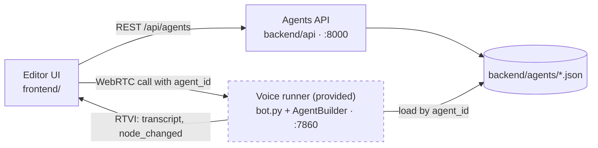

# Overview of the Solution

An agent is a graph of nodes (Pipecat Flows) stored as a JSON document. The editor edits that JSON, the API stores and validates it, and the provided voice runner compiles it with `AgentBuilder` and runs it. Phase 2 (the Copilot) will generate and modify the same JSON.

## Architecture

The voice runner (Pipecat pipeline, ElevenLabs STT/TTS, OpenAI LLM, Pipecat Flows, `AgentBuilder`) was provided and is used as is, apart from the small hooks listed below. The work in this repo is the editor UI, the agents API, and the glue between them and the runner.

### Components

- **Editor UI** (`frontend/`, Vite + React + TypeScript). Agent list, graph canvas (React Flow, dagre auto-layout) and a dock with Inspector, Issues, JSON, Settings and Call tabs. All edits go through actions on one Zustand store that holds the working copy of the agent. A separate call store holds the call state, transcript and active node.
- **Agents API** (`backend/api/`, FastAPI). CRUD on `/api/agents` plus `POST /api/agents/validate`. Agents are files in `backend/agents/<id>.json`, seeded from `example_flow.json`.
- **Voice runner** (`backend/bot.py`, provided). Started by the Call tab with `{agent_id}` in the session body; loads that agent and runs it.

### Decisions

- **Files, not a database.** Single-user local tool. Writes are atomic (temp file + rename), so a failed save leaves the previous version. Ids must be a lowercase slug, so a path cannot escape the directory.
- **One validator.** Rules live in one Python function used by the runner and the API. The UI does not reimplement them; it debounces calls to `/validate` and renders the result. Two small UI-side checks exist only for immediate feedback: the JSON tab refuses documents the canvas cannot draw, and the edge form refuses invalid function names as you type.
- **Layout in the agent JSON.** Positions travel with the agent (duplicate, export, Copilot edits). Nodes without a position are auto-laid out.

## How it was built

The implementation was done with Claude Code, driven by an [OpenSpec](https://github.com/Fission-AI/OpenSpec) change instead of free-form prompts. The spec is in `openspec/changes/add-agent-builder-frontend/`:

| File | Contents |
| --- | --- |
| `proposal.md` | Why the change is needed and what it adds (frontend, agents API, validation, `agent_id` per call). |
| `design.md` | Goals, non-goals, decisions (libraries, storage, validation codes, Pipecat runner contract) and trade-offs. |
| `specs/*/spec.md` | 17 requirements with scenarios across 4 capabilities: agent management, graph editor, agent configuration, test call. |
| `tasks.md` | 30 tasks in 9 vertical slices. Each task names its verification step (a test or a manual check in the browser). |

The process:

1. Give the Phase 1 requirements to the `openspec-propose` skill (`.claude/skills/`), which produced the proposal, design, specs and tasks. Review and edit them before any code.
2. Use the `openspec-apply-change` skill to have the agent implement `tasks.md` one task at a time, run the task's verification, tick the checkbox and commit with the task number (e.g. `(task 1.2)`).
3. When something did not hold (e.g. task 1.1, the live stub-bot check could not run locally), update the spec or leave the task open rather than diverge from it silently.

The spec is the source of truth for scope: anything not in `tasks.md` was not built, and the "left out" list below matches the design's non-goals.

## Phase 1: the agent builder

Delivered as stacked PRs, one per slice in `tasks.md`:

| Slice | Contents |
| --- | --- |
| Skeleton | FastAPI app, Vite/React shell, agent list with loading / empty / error states, `make dev` / `make up`. |
| Agent management | Create, rename, duplicate, delete with confirmation, toasts. |
| Read-only graph | Typed model, API client, store, auto layout, node cards, labelled edges, fit-to-view, minimap. |
| Node editing | Inspector form (name with rename cascade, task messages, role override, pre/post actions as Say / End call steps), save with dirty tracking, Cmd/Ctrl+S, unsaved-changes guard. |
| Edge editing | Connect, retarget and delete edges by dragging; edge form for function, description and collected parameters; draggable labels. |
| Structure and layout | Add / delete node, set initial node, persisted positions, auto layout. |
| Settings, validation, JSON | Persona / voice / model settings; server validation with clickable issues and canvas markers; raw JSON view with *Apply*. |
| Test call | Mic permission, connect, mute, hang up; live transcript with transitions; active node and last edge highlighted on the canvas. |
| Polish | Fit-to-view zoom cap, agent list hover fix, Playwright smoke spec, docs. |

### Extension points for the Copilot

- **Agent JSON contract** (`agent_builder/schema.py`, `frontend/src/model.ts`): the Copilot reads and writes the same document as the editor and the runner. Nodes without a `layout` position are auto-laid out, so generated agents need no coordinates.
- **Validation** (`POST /api/agents/validate`): structured issues with node and edge locations, so generated or edited agents can be checked and fixed in a loop before a human sees them.
- **Store actions** (`frontend/src/store.ts`): `replaceAgent`, `updateNode`, `addEdge`, `renameNode`... apply changes with the same cascades and dirty tracking as manual edits.
- **Dock registry** (`frontend/src/components/Dock.tsx`): a Copilot panel is one more registered tab next to Inspector, Issues, JSON, Settings and Call.
- **Call events** (`node_changed` RTVI messages, transcript in `frontend/src/call/callStore.ts`): which nodes a call went through and what was said, the raw material for spotting issues in calls.

## Phase 2

Agent Copilot. Not started.
