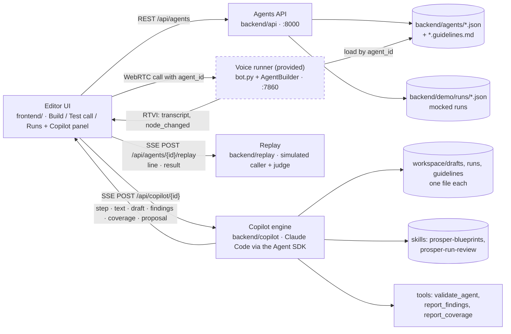

# Solution: an Agent Copilot that works like a deployment engineer

Setup and usage are in the [README](README.md). This document is the argument.

## TL;DR

- **User:** Prosper's deployment team, who set up a voice agent per clinic and keep it working.
- **Implementation:** client guidelines in → agent out, plus a coverage report and the questions to send the client for every policy the guidelines left unsaid.
- **Iteration:** production calls in → findings grouped by cause → a fix → the fix replayed against those calls, before and after.
- **Both loops end in review:** a person reads a diff on the canvas, then Apply and Save. The Copilot never saves.

## The problem

The deployment team has two bottlenecks. First, turning a client's guidelines into an agent means reading a document and building nodes, edges and actions by hand, and the gaps in the guidelines (what happens on a cancellation? who is the human?) surface late, after the agent is built. Second, once the agent is live, improving it means finding what is wrong in call data, and that finding is itself manual: someone has to listen to or read calls. Flags only catch part of it. In the demo data most failing runs are unflagged (Riverside: 6 failing runs, 3 flagged; Sunrise: 8 failing, 3 flagged; failing means abandoned, stuck or flagged), so the Copilot reads every run, not only the flagged ones.

## The idea

A Prosper Copilot produces what the engineer would produce by hand.

| Workflow | In | Out |
| --- | --- | --- |
| Implementation | Guidelines (pasted or `.md`/`.txt`) | The agent; a **coverage card** (each requirement, its source quote, the nodes that implement it); **questions for the client**, each with the safe default the agent follows meanwhile, and *Copy as email*. Paste the client's answers and the questions close. |
| Iteration | An agent's production runs | **Findings** (cause, fix, run ids), a proposed edit, and, if the engineer agrees to the cost, a **replay** by a simulated caller of the cited runs plus a few that worked, on the old and new agent: "Fixed 5 of 6 failing calls · 3 of 3 working calls still work". |

Every change shows as a diff on the canvas.

## Architecture

An agent is one JSON document (a Pipecat Flows graph). The editor, the API, the Copilot and the provided voice runner all read and write that same document. The runner is used as is, apart from reading an `agent_id` per call. See `backend/copilot/README.md` and `backend/replay/README.md`.

## Key decisions and trade-offs

- **Claude Code embedded via the Agent SDK.** "Read the file, edit, run the checker, fix" is what it does with source code, and it brings editing, sessions and the tool loop. *Instead of:* a raw API loop that returns the whole JSON each turn.
- **Small edits to a draft file, validation in the loop.** The model can only read and `Edit` the draft, so diffs stay reviewable. It is instructed to call `validate_agent` after its last edit and fix what it reports, but that is a prompt, not a lock. The server re-validates every proposal anyway, and the card lists any issues left.
- **Review before apply.** *Instead of:* auto-apply.
- **Replays stream line by line.** A replay takes several model turns, so the server sends each transcript line as it is spoken (a `line` event, then the `result` with the verdict). The engineer watches the simulated call unfold instead of a spinner, and can open a row mid-call. *Instead of:* waiting for the whole result.
- **Replay is opt-in.** Each replayed call is about 15 small model calls, twice (before and after). The card under a proposal says how many calls it would replay and that it costs money; nothing runs until the engineer clicks. *Instead of:* replaying automatically when the Copilot proposes a fix.
- **Text replay, not voice.** Seconds and cents per call, and it tests the graph, which is what a fix changes. Each run is played before and after, so a failure that reproduces on *before* shows the simulator is credible. *Instead of:* phone calls through the voice runner.

## Demo walkthrough

Needs the `claude` CLI login or key, and `OPENAI_API_KEY` for replay and the test call. Open `http://localhost:5173`.

1. `make up`, then `make demo` (re-run it to reset the demo agents).
2. **Implementation.** Home, *New from guidelines*, *Use sample: Harbor Dental Reschedule*, *Create and build*.
   - Point at: steps streaming, the graph growing node by node (green) on the canvas, the **coverage card** (each requirement with its source quote and nodes), and the **questions for the client** with the default the agent follows meanwhile.
   - *Copy as email*, then *Use sample client reply*, Send: the questions it answers close (a real Sonnet run leaves one, office hours, which the reply does not settle). Apply, Save.
3. **Iteration.** Open *Riverside Scheduler* (`demo-riverside-scheduler`), Runs tab. Point at the outcome counts and the unflagged failures. *Analyze runs*.
   - Point at: the **Findings** card (cause, fix, run ids; a run id opens that run and draws its path), then the proposal diff on the canvas.
   - *Replay N calls*: calls stream line by line. The summary reads "Fixed X of Y failing calls · N of N working calls still work". Apply, Save.
4. **Test call.** Test call tab, start a call, watch the active node move on the canvas.

Riverside is the iteration demo because its failures reproduce best in replay.

**3-minute path:** skip the build. Do step 2 only up to the coverage card and *Copy as email* (about a minute), then step 3 in full, then Apply. Skip the test call unless there is a microphone.

## What was built, mocked, and left out

| Choice | Why |
| --- | --- |
| **Mocked:** production runs. Hand-written fixtures, about 8 per agent, each with a planted flaw. No call capture. | The brief provides no call data. The demo needs the shape of a run, not a recording pipeline. |
| **Text replay, not voice.** | Seconds and cents per call, and it tests the graph, which is what a fix changes. |
| **The replay judge is an LLM** (`gpt-4o-mini`), one sample per run. | Results are a signal, not proof. Each run is also replayed on *before*; a failure that does not reproduce is shown as "not reproduced", not counted as fixed. |
| **Copilot sessions live in API memory.** | A restart starts a fresh session; the chat stays in the browser. Fine for a local tool. |
| **Single user, no auth, no versioning or deploy.** | Save writes the file. Versions and deploy are a product of their own. |
| **No rename detection in the diff.** | A renamed node shows as one removed and one added. |
| **Analysis is per agent.** | Runs belong to one graph version; cross-agent patterns are a later problem. |
| **No limit on copilot turns, on purpose.** | Claude Code manages its own loop; the engineer can press Stop. |

## Testing

- **Backend:** pytest. **Frontend:** Vitest. **End to end:** one Playwright smoke spec. **Static:** `make lint` (ruff and `tsc`), and GitHub Actions CI runs the suites and lint.
- **Claude and OpenAI are faked in all automated tests,** for cost and determinism: a scripted SDK client for the copilot, a fake chat client for replay, and network stubs in Playwright.
- **The real paths are checked by hand-run targets:** `make check-guidelines` does a real copilot build of the Harbor sample and compares it with `harbor-dental-reschedule.expected.json`; `make demo-check` does real replays of every demo run.

Latest results (2026-10-31): pytest 408 passed, Vitest 340 passed, Playwright 5 passed, ruff and `tsc` clean. `make check-guidelines MODEL=sonnet` held 18 of 18 expectations in four runs in a row (3 questions after the build, 1 after the client's reply); `MODEL=haiku` held 18 of 18 once. `make demo-check` on the unmodified agents: Riverside reproduces 5 of its 6 failing runs; Lakeside's working calls stay working; Sunrise reproduces 3 to 8 of 8 depending on the run, because the `gpt-4o-mini` judge is noisy on whether an improvised answer counts. That noise is why the demo uses Riverside, and why more samples per run are a next step.

## Next steps

- **Scale.** With thousands of calls, reading all of them does not work. Pre-filter by outcome and flags, cluster by failing node and path, review a sample per cluster, then replay more samples per run so the verdict is statistically meaningful.
- **Call capture.** Record real calls into the run format.
- **Versioning and deploy with a replay gate.** Block a deploy when the replay shows a working call breaking.
- **Persisted sessions.** Copilot conversations that survive an API restart.
- **Continuous detection.** Run the analysis on a schedule and open the findings for the engineer, instead of waiting for *Analyze runs*.

## How it was built

Claude Code driven by [OpenSpec](https://github.com/Fission-AI/OpenSpec): `openspec-propose` turned requirements into a proposal, design, specs and tasks reviewed before code; `openspec-apply-change` implemented tasks one at a time, each with its verification. Until the review fixes below, anything not in a change's `tasks.md` was not built. Changes are in `openspec/changes/archive/`, specs in `openspec/specs/`.

Three tasks stayed open at archive: the final Phase 1 demo run (9.3), browser timing of the guidelines demo (5.2 of the guidelines change), and the click-path write-up of the solution rewrite (2.2), which the *Demo walkthrough* above now covers. The fixes from the review were made directly on a branch, outside OpenSpec: judge strictness, the replay scoring baseline (a working call counts as broken only if *after* does worse than *before*), guidelines question discipline and a Sonnet default for the Copilot, keeping the partial draft as an incomplete proposal when a turn fails, and lint with CI.
