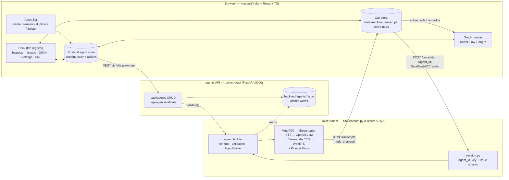

# Overview of the Solution

An agent is a **graph of nodes** (Pipecat Flows) stored as declarative JSON. One JSON contract is shared by everything: the editor UI edits it, the validator checks it, `AgentBuilder` compiles it into a runnable voice pipeline, and (Phase 2) the Copilot will generate and modify it.

## Architecture Overview

Key points:

- **One contract, one validator.** `agent_builder/validation.py` produces structured issues (code, severity, node/edge). `AgentBuilder` refuses to build an agent with errors, the API exposes the same function at `POST /api/agents/validate`, and the UI shows the result in the Issues tab and on the canvas.
- **Files, not a database.** Agents are `backend/agents/<id>.json`, seeded from `example_flow.json`. Writes are atomic (write temp, rename) so a failed save leaves the old file intact. Ids are validated (lowercase slug) so the path can never escape the directory.
- **The runner has no graph logic.** `bot.py` only wires the pipeline; the agent it runs is chosen per session by the `agent_id` in the `/start` body.
- **UI layout is data.** Node positions and edge-label offsets are saved in an optional `layout` key in the same JSON; nodes without a position are auto-laid-out (dagre, left to right).

## Phase 1 — the agent builder

What was built, in the order it was delivered (each step shipped as its own stacked PR):

| Slice | What you get |
| --- | --- |
| Skeleton | FastAPI app, Vite/React shell, agent list with loading / empty / error+retry states, `make dev` / `make up`. |
| Agent management | Create (starter agent), rename, duplicate, delete with confirmation, toasts, navigation. |
| Read-only graph | Typed model, API client, store, auto layout, custom node cards, labelled edges, fit-to-view, minimap. |
| Node editing | Inspector form (name with rename cascade, task messages, role override, pre/post actions), save with dirty tracking, Cmd/Ctrl+S, leave-without-saving guard. |
| Edge editing | Connect, retarget and delete edges by dragging; edge form for the function, description and collected parameters; draggable labels. |
| Structure & layout | Add / delete node, set initial node, drag-to-place positions persisted as `layout`, auto layout. |
| Settings, validation, JSON | Persona / voice / model settings; debounced server validation with clickable issues and canvas markers; raw JSON view with safe *Apply*. |
| Test call | Call tab: mic permission, connect, mute, hang up; live transcript with transition notes; active node and last edge highlighted on the canvas. |
| Polish & hand-off | Fit-to-view zoom cap, hover-action fix in the agent list, Playwright smoke spec, docs. |

### Testing

- **pytest** (backend): API routes, id rejection, atomic saves, validation issue codes, session helpers.
- **Vitest** (frontend): store actions (rename cascade, delete, connect, JSON apply, layout), form and dialog behaviour, call store driven by a fake client and mocked RTVI events.
- **Playwright**: one smoke spec against the real API with a throwaway agents directory — create → add a node → save → reload → open the seeded agent → open the Call tab, failing on any console error. `make test` runs all three.
- **Manual**: `docs/manual-call-test.md`, for the part that needs a microphone and paid API keys.

### What is mocked or left out, and why

| Item | Status | Why |
| --- | --- | --- |
| Real voice call | Implemented, **tested only with a fake client** in CI | Needs `OPENAI_API_KEY` and `ELEVENLABS_API_KEY` and a mic; covered by the manual checklist. |
| Auth, multi-user, versioning | Left out | Single-user local tool; files in `backend/agents/` are the store. |
| Mobile / small screens | Left out | Authoring a graph is a laptop task; checked at 1440 and 1280 px only. |
| Undo / redo | Left out | The JSON tab and the unsaved-changes guard cover recovery for now. |
| Call setup errors in the UI | Limited | The runner cannot report them before a session exists, so the UI shows a timeout and the runner log has the cause. |

### Extension points for Phase 2 (the Copilot)

- **Store actions** (`frontend/src/store.ts`): every edit goes through a named action (`updateNode`, `addEdge`, `renameNode`, `replaceAgent`, …). The Copilot can call these directly, so its changes get the same dirty tracking and validation as manual edits.
- **Dock registry** (`DOCK_TABS` in `frontend/src/components/Dock.tsx`): add a `{id, label, component}` entry for a Copilot chat tab.
- **Agent JSON contract** (`backend/agent_builder/schema.py`, `validation.py`): the Copilot generates JSON and gets back structured issues from `POST /api/agents/validate` to self-correct before anything is saved.
- **RTVI messages** (`backend/session.py`): `node_changed` `{from, node, via, args}` already travels to the UI; further server messages can reuse the channel.

## Phase 2

The AI Composer: generate and iterate on agents from natural language, using the extension points above. Not started.
