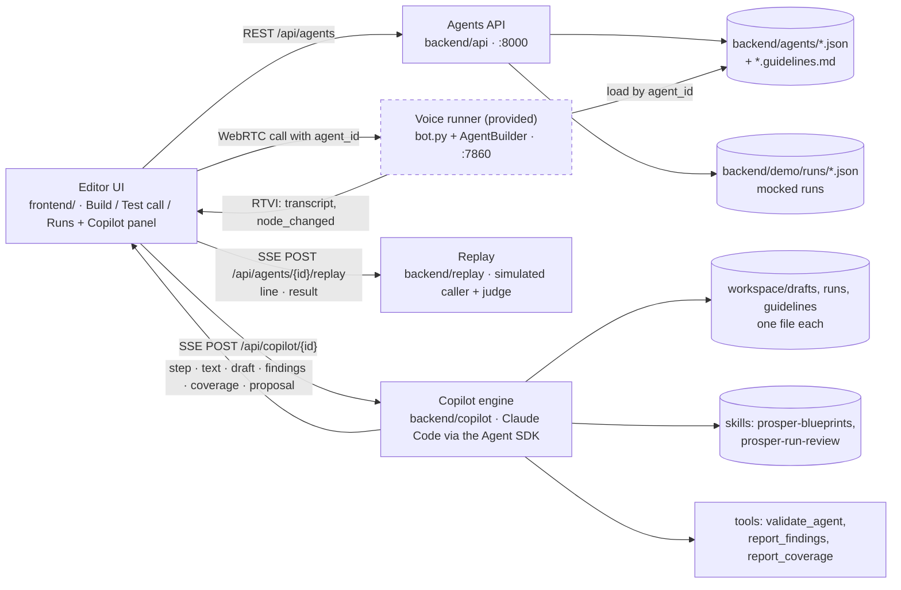

# Solution: an Agent Copilot that works like a deployment engineer

Setup and usage are in the [README](README.md). This document is the argument.

## TL;DR

- **User:** Prosper's deployment team, who set up a voice agent per clinic and keep it working.
- **Implementation:** client guidelines in → agent out, plus a coverage report and the questions to send the client for every policy the guidelines left unsaid.
- **Iteration:** production calls in → findings grouped by cause → a fix → the fix replayed against those calls, before and after.
- **Both loops end in review:** a person reads a diff on the canvas, then Apply and Save. The Copilot never saves.

## The problem

Creating agents takes a long time since it requires adding nodes edges and actions manually. Transfering requirements into an actual agent can take time and every time it requires an iteration/change manual work can be tedious and slow.

## The idea

A Prosper Copilot produces what the engineer would produce by hand.

| Workflow | In | Out |
| --- | --- | --- |
| Implementation | Guidelines (pasted or `.md`/`.txt`) | The agent; a **coverage card** (each requirement, its source quote, the nodes that implement it); **questions for the client**, each with the safe default the agent follows meanwhile, and *Copy as email*. Paste the client's answers and the questions close. |
| Iteration | An agent's production runs | **Findings** (cause, fix, run ids), a proposed edit, and, if the engineer agrees to the cost, a **replay** by a simulated caller of the cited runs plus a few that worked, on the old and new agent: "Fixed 5 of 6 failing calls · 3 of 3 working calls still work". |

Every change shows as a diff on the canvas.

## Architecture

An agent is one JSON document (a Pipecat Flows graph). The editor, the API, the Copilot and the provided voice runner all read and write that same document. The runner is used as is, apart from reading an `agent_id` per call. See `backend/copilot/README.md` and `backend/replay/README.md`.

## Key decisions and trade-offs

- **Claude Code embedded via the Agent SDK.** "Read the file, edit, run the checker, fix" is what it does with source code, and it brings editing, sessions and the tool loop. *Instead of:* a raw API loop that returns the whole JSON each turn.
- **Small edits to a draft file, validation in the loop.** The model can only read and `Edit` the draft and must validate after its last edit, so diffs stay reviewable. 
- **Review before apply.** *Instead of:* auto-apply.
- **Replays stream line by line.** A replay takes several model turns, so the server sends each transcript line as it is spoken (a `line` event, then the `result` with the verdict). The engineer watches the simulated call unfold instead of a spinner, and can open a row mid-call. *Instead of:* waiting for the whole result.
- **Replay is opt-in.** Each replayed call is about 15 small model calls, twice (before and after). The card under a proposal says how many calls it would replay and that it costs money; nothing runs until the engineer clicks. *Instead of:* replaying automatically when the Copilot proposes a fix.
- **Text replay, not voice.** Seconds and cents per call, and it tests the graph, which is what a fix changes. Each run is played before and after, so a failure that reproduces on *before* shows the simulator is credible. *Instead of:* phone calls through the voice runner.

## How it was built

Claude Code driven by [OpenSpec](https://github.com/Fission-AI/OpenSpec): `openspec-propose` turned requirements into a proposal, design, specs and tasks reviewed before code; `openspec-apply-change` implemented tasks one at a time, each with its verification. Anything not in a change's `tasks.md` was not built. Changes are in `openspec/changes/archive/`, specs in `openspec/specs/`. Two tasks stayed open at archive: the final Phase 1 demo run (9.3) and browser timing of the guidelines demo (5.2 of the guidelines change).
