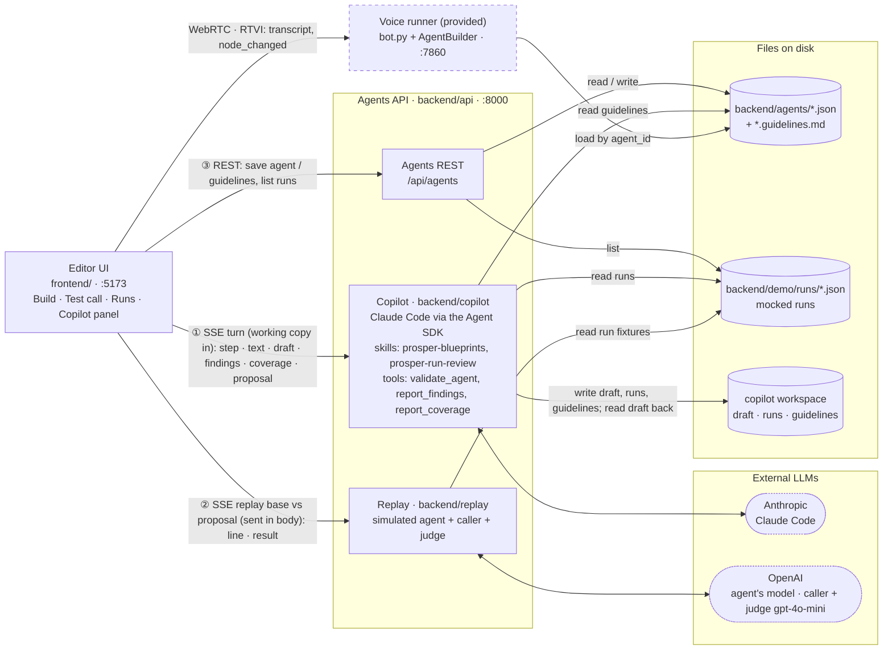

# Solution: an Agent Copilot that works like a deployment engineer

For the setup instructions check [README](README.md).

## TL;DR

- **User:** Prosper's deployment team. They check the client's needs and act upon them.
- **Implementation:** client guidelines → agent creation 
- **Iteration:** production calls in → findings grouped by cause → fix proposal → replay the fix to check if the solution improved.
- **Review** Prosper's deployment team check the new solution and approves/discards.

## The problem

```[ASSUMPTION]``` The Prosper team has two bottlenecks. First, turning a client's guidelines into a agents means gathering client requirements and building nodes, edges and actions by hand, this proces is long. Morover gaps in the impementation surface later. Second, once the agent is live, improving it means finding error patterns in lots of call data.

## The idea

A Prosper Copilot reduces engineering workloads by analyzing user requirements, checking live traces and understanding natural language to create and evolve agents for the clients.
The Coplitot des not stop there, it is able to identify gaps in the initial requirements and asks the developer to clarify this questions with the clients. E.g. missing working hours of a hosptial.

## Architecture



## Key decisions and trade-offs

- **Claude Code + SKILLS:** To avoid the reimplementation of an agent with LanGraph (and a potentially worse performance), the solution uses Claude Code and a set of skills to set up the behaviour.
- **Small edits to a draft file, validation later.** The model can only read and `Edit` the draft, so diffs stay reviewable. It is instructed to call `validate_agent` after its last edit and fix what it reports, but that is a prompt, not a lock (possible miss here). The server re-validates every proposal anyway, and the card lists any issues left.
- **Text replay, not voice.** Saves costs.

## What was built, mocked, and left out

| Choice | Why |
| --- | --- |
| **Mocked:** production runs. Generated fixtures, about 8 per agent, each with a planted flaw. No call capture. | Not enought tine to implement a feedback system |
| **The replay judge is an LLM** (`gpt-4o-mini`) | Follows the industry standard of an LLM as a judge |
| **No rename detection in the diff.** | A renamed node shows as one removed and one added. |
| **Agent Isolation** | You cannot point to another agent since it increases complexity and evaluation of the agent gets harder. |
| **No limit on copilot turns, on purpose.** | Claude Code manages its own loop; the engineer can press Stop. |

## Testing

- **Backend:** pytest. **Frontend:** Vitest. **End to end:** one Playwright smoke spec. **Static:** `make lint` (ruff, ESLint, `tsc` and format checks; `make format` fixes what it can), and GitHub Actions CI runs the suites and lint.
- **Claude and OpenAI are faked in all automated tests,** for cost and determinism.
- **The real paths are checked by hand-run targets:** `make check-guidelines` does a real copilot build of the Harbor sample and compares it with `harbor-dental-reschedule.expected.json`; `make demo-check` does real replays of every demo run.


## Potential Next steps

- **Scale.** With thousands of calls this solution does not scale since LLMs have finite context and wont be able to get them all. priorize by relevance to the client and higest impact.
- **Call tracing.** Record the real calls.
- **Versioning and quality gate** Never deploy an agent that does not pass the quality gate/ golden dataset.
- **Persisted sessions.** Copilot conversations that survive an API restart.
- **Auto Improvement** The developer gets direct proactive suggestions on what could be improved when they open the tool instead of manually having to ask the copilot. This closes the Evaluation Flywheel.

## How it was built

Claude Code driven by [OpenSpec](https://github.com/Fission-AI/OpenSpec): `openspec-propose` turned requirements into a proposal, design, specs and tasks reviewed before code; `openspec-apply-change` implemented tasks one at a time, each with its verification. Until the review fixes below, anything not in a change's `tasks.md` was not built. Changes are in `openspec/changes/archive/`, specs in `openspec/specs/`.
